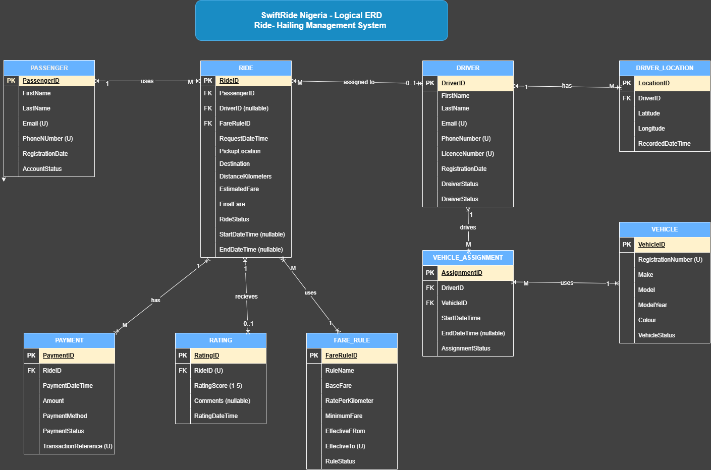

# SwiftRide Nigeria: Ride-Hailing Database Management System

## Case Study

---

## 1.1 Introduction

SwiftRide Nigeria is a simulated ride-hailing company operating in Lagos, Abuja, and Port Harcourt. The company provides a digital platform through which passengers can request rides, view fares, track drivers, and make payments. Drivers use the platform to manage their availability, accept ride requests, and update trip statuses.

As the company expands, it requires a reliable and scalable database system to manage passenger information, driver registrations, vehicle assignments, ride requests, fare calculations, payment transactions, customer ratings, and driver locations.

---

## 1.2 Problem Statement

SwiftRide Nigeria faces several potential database management challenges as its operations grow. These include:

- **Data duplication:** Repeated passenger, driver, and vehicle information across records.
- **Data inconsistency:** Different records containing conflicting information about rides, payments, or account statuses.
- **Assignment conflicts:** A driver or vehicle being assigned to multiple active assignments.
- **Financial inaccuracies:** Incorrect fare calculations or invalid payment amounts.
- **Performance issues:** Slow queries when retrieving ride histories, payment information, and operational reports.
- **System availability risks:** Service interruptions resulting from server or network failures.
- **Data integrity risks:** Records referencing passengers, drivers, or rides that do not exist.

These challenges highlight the need for a properly designed relational database with effective data integrity rules, transaction management, indexing, and recovery mechanisms.

---

## 1.3 Aim of the Project

The aim is to design, implement, analyse, and evaluate an advanced database management system for SwiftRide Nigeria using Microsoft SQL Server and complementary technologies.

---

## 1.4 Project Objectives

1. Design an Entity–Relationship Diagram (ERD) and relational database schema.
2. Implement the database in Microsoft SQL Server using keys, constraints, and normalization.
3. Develop SQL queries for ride operations and business reporting.
4. Analyze query execution plans and optimize performance through indexing.
5. Implement and test transactions, including commit, rollback, isolation, and concurrency control.
6. Design a NoSQL model for driver location tracking and compare it with the relational approach.
7. Investigate replication, high availability, fault tolerance, backup, and recovery.
8. Maintain project documentation and a GitHub repository demonstrating progressive development.

---

## 1.5 Database Scope and Entities

The proposed relational schema contains nine tables.

| Table | Purpose |
|---|---|
| `PASSENGER` | Stores passenger registration and contact details. |
| `DRIVER` | Stores driver registration, contact, and license information. |
| `VEHICLE` | Stores vehicle registration and descriptive details. |
| `VEHICLE_ASSIGNMENT` | Maintains the history of driver–vehicle assignments. |
| `FARE_RULE` | Stores pricing rules and their effective periods. |
| `RIDE` | Records ride requests, assignments, journey details, and fares. |
| `PAYMENT` | Records payment transactions and payment attempts. |
| `RATING` | Stores passenger feedback and ride ratings. |
| `DRIVER_LOCATION` | Stores timestamped driver coordinates for tracking. |

The `RIDE` table serves as the central operational table, connecting passengers, drivers, and fare rules. Other tables manage supporting information and business processes.

---

## 1.6 Entity–Relationship Diagram (ERD)

*Figure 1: Entity–Relationship Diagram for the SwiftRide Nigeria database.*